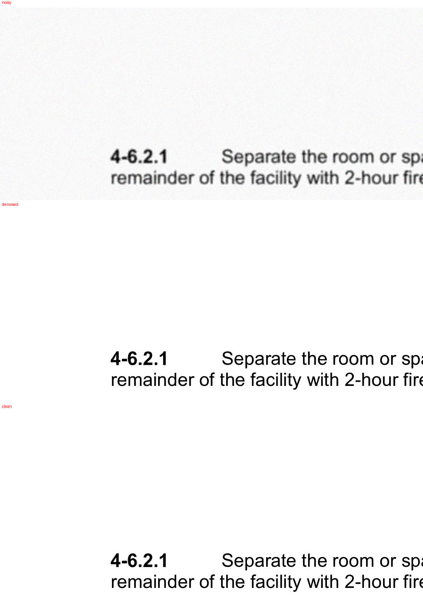

# Document Image Denoising

Removes JPEG compression artifacts, blur, and noise from scanned document images. PyTorch/Lightning training pipeline, six trained architecture/width variants benchmarked head-to-head, quantized to int8 ONNX, and evaluated on CPU latency.

**[Models (Hugging Face)](https://huggingface.co/jere1882/document-image-denoising)** · **[Training data (Kaggle, 50k crops)](https://www.kaggle.com/datasets/jeremiasrodriguez/document-crops-50k)**


Real PDF page, not a synthetic sample — see [below](#full-real-pages) for full-page results.

## Results

Six models, identical data/degradation/seed, trained 10 epochs on 2×T4 GPUs. PSNR is one global value from the summed squared error over the full held-out validation split (not an average of per-image PSNRs — those disagree by several dB and aren't the same quantity).

| Model | Params | PSNR fp32 | PSNR int8 | Size fp32→int8 | CPU latency fp32→int8* |
|---|---|---|---|---|---|
| `unet` (bc64) | 7.70M | 30.33 dB | 30.24 dB | 30.8MB → 7.8MB | 288 → 243 ms |
| `residual_unet` (bc64) | 7.70M | 30.25 dB | 30.18 dB | 30.8MB → 7.8MB | 286 → 239 ms |
| `residual_unet` (bc32) | 1.93M | 30.03 dB | 30.00 dB | 7.7MB → 2.0MB | 90 → 76 ms |
| `residual_unet` (bc16) | 0.48M | 29.22 dB | 29.22 dB | 1.9MB → 0.5MB | 44 → 34 ms |
| `residual_unet` (bc8) | 0.12M | 27.36 dB | 27.23 dB | 0.5MB → 0.16MB | 18 → 18 ms |
| `plain_encoder_decoder` (bc64) | 6.93M | 28.28 dB | 28.20 dB | 27.7MB → 7.0MB | 239 → 194 ms |

\* Single 512×512 tile, batch 1, 4 CPU threads, one machine (Apple Silicon) — not a general hardware claim. int8 is static-quantized (QDQ, per-channel weights), calibrated on training crops never seen by the validation set.

**Findings:**
- Residual learning (predict the noise, subtract it) converges faster in early epochs but reaches the *same* final PSNR as predicting the clean image directly — no final-quality edge, despite that being the usual assumption.
- Skip connections matter far more than width: removing them (`plain_encoder_decoder`) costs ~2 dB; cutting `residual_unet` to 32 channels (25% of params) costs 0.2 dB.
- int8 quantization costs ≤0.14 dB everywhere, with a consistent ~4× size reduction.

## Tech stack

| | |
|---|---|
| Training | PyTorch, PyTorch Lightning, DDP (multi-GPU) |
| Config | Hydra (every hyperparameter CLI-overridable) |
| Experiment tracking | Weights & Biases |
| Compute / data hosting | Kaggle (T4×2 GPUs, dataset hosting) |
| Export & quantization | ONNX, ONNX Runtime (static int8, QDQ) |
| Benchmarking | `torch.utils.benchmark`, `onnxruntime_perf_test`, `perf_counter` (cross-checked against each other) |
| Data pipeline | PyMuPDF (PDF rendering), OpenCV |
| Model hosting | Hugging Face Hub |

## Full real pages

The table above is on 512×512 crops; the model also runs tiled inference on full-size
pages (overlapping 512×512 tiles blended with a 2D Hann window — see
[`docs/tiled_inference.md`](docs/tiled_inference.md) for both the PyTorch and ONNX
backends, and a measured, counterintuitive answer to whether batching tiles together
helps on CPU — it doesn't). The hero image above and the two below are real PDF pages
from the training corpus's own held-out split, picked because they had the largest
measured denoising gain among 800 scanned held-out crops:




## Project layout

```
.
├── data/crops/clean/                  # generated dataset (gitignored)
├── notebooks/
│   └── kaggle_train.ipynb             # runnable: clone + train on a free Kaggle GPU
├── outputs/                           # checkpoints, logs, exports (gitignored)
├── scripts/
│   ├── build_tiling_demo.py           # synthetic-mosaic tiling demo + batching benchmark
│   └── build_page_candidates.py       # colorfulness-ranked demo-page candidates
├── src/denoising/
│   ├── conf/                          # Hydra configs (data, model, trainer, logger, predict, infer)
│   ├── callbacks.py                   # W&B prediction image logging callback
│   ├── data/                          # dataset, datamodule, degradation pipeline, PDF→crop extraction
│   ├── models/                        # UNet, PlainEncoderDecoder, ResidualUNet, Lightning module
│   ├── export/                        # checkpoint → ONNX fp32 → int8, PSNR/size/latency report
│   ├── utils/                         # device + metrics
│   ├── train.py / predict.py / infer.py   # Hydra @main entry points
├── docs/tiled_inference.md            # full-page inference: PyTorch/ONNX backends, a real bug found and fixed, batching
└── tests/test_smoke.py                # shape/backward/metric smoke tests
```

Architecture is decoupled from training: backbone models are pure `nn.Module` classes importable from notebooks or tests; `DenoisingLitModule` is the Lightning wrapper that owns loss, optimizer, and metric logging, and selects the backbone by name from config.

## Setup

```bash
python3.13 -m venv .venv && source .venv/bin/activate
pip install -e .
```

`accelerator: auto` picks the best available device (CUDA, Apple Silicon MPS, or CPU) with no config changes.

### Optional: Weights & Biases

```bash
wandb login   # one-time; without this, training defaults to CSV logging
```

### Running on Kaggle (free GPU)

1. Upload your crops dir as a private [Kaggle Dataset](https://www.kaggle.com/datasets), or use the [public 50k-crop dataset](https://www.kaggle.com/datasets/jeremiasrodriguez/document-crops-50k) above.
2. Import [`notebooks/kaggle_train.ipynb`](notebooks/kaggle_train.ipynb) as a new Kaggle Notebook (File → Import Notebook).
3. Settings: GPU accelerator + Internet on, attach the dataset via **+ Add Input**.
4. Run. The notebook clones this repo fresh and trains with `data.clean_dir`/`hydra.run.dir` set to the Kaggle paths — push any code/config changes first, it always trains `master`, not your working tree.

## Usage

Hydra dotted overrides work on every command (`data.batch_size=4`, `model=residual_unet`, `++trainer.fast_dev_run=true`, etc.).

```bash
# 1. PDFs -> 512x512 crops
denoising-extract-crops --pdf-dir ~/Downloads/pdfs --output-dir data/crops --scale 4.0 --target-crops 10000

# 2. Train (swap model=unet | residual_unet | plain_encoder_decoder)
denoising-train model=residual_unet trainer.max_epochs=10 hydra.run.dir=outputs/my_run

# 3. Demo grid from held-out validation crops
denoising-predict predict.checkpoint=outputs/my_run/checkpoints/last.ckpt

# 4. Full-page inference (PyTorch or, with infer.onnx_path=, the quantized ONNX model)
denoising-infer infer.checkpoint=outputs/my_run/checkpoints/last.ckpt infer.input=page.png

# 5. Export + quantize to ONNX, with a PSNR/size/latency report
denoising-export --checkpoint outputs/my_run/checkpoints/last.ckpt --clean-dir data/crops/clean --out-dir outputs/my_run/export
```

Checkpoints resume with `ckpt_path=...`; W&B logging with `logger=wandb` (after `wandb login`).

## Degradation pipeline

Applied per crop during training, in order — Gaussian blur → JPEG round-trip → Gaussian noise, each with its own probability and parameter range (`conf/data/default.yaml`):

| Step | Default prob | Parameters |
|---|---|---|
| `gaussian_blur` | 0.5 | radius ∈ [0.5, 2.5] |
| `jpeg` | 1.0 | quality ∈ [5, 25] |
| `gaussian_noise` | 0.7 | sigma ∈ [0.01, 0.06] |

Override on the CLI: `denoising-train 'data.degradations=[{type: jpeg, prob: 1.0, quality_min: 5, quality_max: 30}]'`. To add a new degradation: implement a callable in `transforms.py`, register it in `DegradationPipeline._REGISTRY`.

## Architecture

| Config key | Class | Description |
|---|---|---|
| `unet` | `UNet` | 3 encoder/decoder levels with skip connections (64→128→256→512) |
| `plain_encoder_decoder` | `PlainEncoderDecoder` | Same depth, no skip connections — ablation baseline |
| `residual_unet` | `ResidualUNet` | Predicts the noise residual (tanh-bounded) and subtracts it |

All are fully convolutional (any input resolution; trained at 512×512). `base_channels` controls width for any of the from-scratch backbones. To add an architecture: implement an `nn.Module` in `models/`, register it in `_BACKBONES` in `lit_module.py`, add a config under `conf/model/`.

## Tests

```bash
pip install -e ".[dev]" && pytest tests/
```

## Further reading

- [`docs/tiled_inference.md`](docs/tiled_inference.md) — full-page inference, PyTorch/ONNX backends, a real edge-case bug found via an identity-predictor test, and CPU batching results
