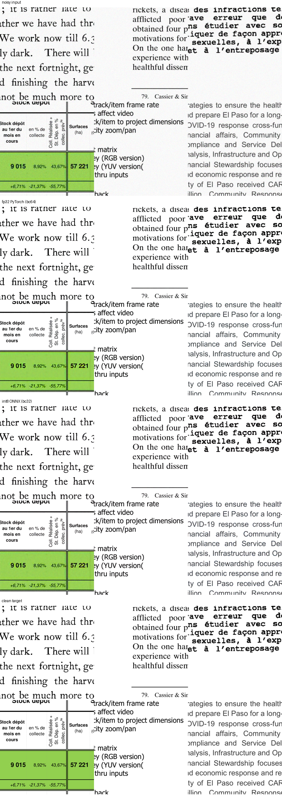

# Tiled inference: PyTorch and ONNX, and whether batching helps on CPU

`denoising-infer` (`src/denoising/infer.py`) denoises a full document page of any
size by splitting it into overlapping 512×512 tiles, running the model on each,
and blending the overlaps back together with a 2D Hann window. This matters
because every model in this repo was trained on 512×512 crops, so a real page
has to go through this path rather than the model directly.

## What changed

The tiling code originally only accepted a PyTorch `nn.Module`. The quantized
ONNX models (see the main README's quantization section) had no way to run on
a full page at all. `tile_denoise` now takes a generic `predict(batch) ->
batch` callable instead of a model object, with two ready-made predictors:

```python
from denoising.infer import make_predictor, tile_denoise

predict = make_predictor(checkpoint="run/checkpoints/best.ckpt", onnx_path=None, device=device)
# or, to run the quantized model instead:
predict = make_predictor(checkpoint=None, onnx_path="run/export/model_int8.onnx", device=device)

denoised = tile_denoise(page_image, predict, tile_size=512, overlap=32, batch_size=8)
```

From the CLI, set `infer.onnx_path` to switch backends; leaving it unset keeps
the original PyTorch path:

```bash
# PyTorch checkpoint (unchanged default)
denoising-infer infer.checkpoint=outputs/my_run/checkpoints/last.ckpt infer.input=page.png

# ONNX (fp32 or int8) on CPU, no checkpoint needed
denoising-infer infer.onnx_path=outputs/my_run/export/model_int8.onnx infer.input=page.png
```

| Config key | Default | Meaning |
|---|---|---|
| `infer.checkpoint` | `outputs/checkpoints/last.ckpt` | PyTorch backend, ignored if `onnx_path` is set |
| `infer.onnx_path` | `null` | ONNX backend (fp32 or int8); takes priority over `checkpoint` |
| `infer.tile_size` | `512` | must match training resolution for every model in this repo |
| `infer.overlap` | `32` | pixel overlap between adjacent tiles |
| `infer.batch_size` | `1` | tiles sent to `predict()` per call — measured slower at 8, see below |

## A real bug this surfaced

`torch.hann_window(size, periodic=False)` is exactly `0` at both endpoints of
the 1D window. At the outer border of the whole page, only one tile covers
each pixel, so a weight of exactly `0` there meant the blended output divided
by (clamped) zero weight — i.e. the page border silently went black. Caught by
running `tile_denoise` with an identity predictor and diffing the output
against the input: 0.45% of pixels were off by up to 254/255, concentrated at
the border. Fixed by flooring the window at `1e-3`, which has no visible effect
on the interior blending (where two windows' tails overlap, so the floor is
negligible next to the real weight) but guarantees every pixel gets a non-zero
total weight. Verified clean (max diff 1/255, pure uint8 rounding) across a
normal page, an exact-tile-size image, an extreme aspect ratio, and an odd
size not divisible by the stride.

## Demo

There's no real multi-page scan in this repo (`data/` only has 512×512 crops),
so the demo page below is a synthetic mosaic: six real held-out crops
(`residual_unet` width ablation's own validation split, seed 42) tiled into a
1536×1024 composite, then degraded once as a whole with the standard
pipeline. It's built by `outputs/build_tiling_demo.py`. This exercises real
multi-tile stitching (the 512-stride tiling grid doesn't line up with the
512-crop mosaic grid, so the actual tile boundaries cut across crops, not
between them) without claiming to be a real scanned document.



Both backends (`residual_unet` bc64 fp32 PyTorch, bc32 int8 ONNX) produce
output visually indistinguishable from the clean target on this mostly-text
composite — consistent with the width-ablation finding that text content
saturates quality early (see the main README).

## Does batching tiles help on CPU?

No for PyTorch, and no measurable effect either way for ONNX int8, on this
machine (4 threads pinned to match the rest of this project's latency
methodology, 12 tiles total after padding):

| Backend | batch_size=1 | batch_size=8 |
|---|---|---|
| PyTorch fp32 (`residual_unet` bc64) | 5.2–5.3 s | 7.2–7.5 s (+38–41%, reproducible across repeats) |
| ONNX int8 (`residual_unet` bc32) | 0.87–0.97 s | 0.84–1.05 s (no consistent direction across 6+ repeats) |

PyTorch's regression is the opposite of the usual GPU intuition, where
batching amortizes kernel-launch overhead. On this CPU, a single 512×512 tile
already keeps every core busy, so stacking more tiles into one call adds
memory traffic (bigger intermediate activations) without finding more
parallelism to use. ONNX Runtime's int8 kernels apparently don't hit the same
wall — the batch_size=1 and batch_size=8 numbers overlap, regardless of which
one runs first, so there's no real effect to report there, just measurement
noise at these sub-second durations.

This was only tested on one machine with one page size; it's not a general
claim about CPU inference, just what happened here. The default is now
`batch_size: 1`, since it's never worse and is clearly better for the PyTorch
path — if you're on different hardware, it's worth re-running
`scripts/build_tiling_demo.py` before raising it.
